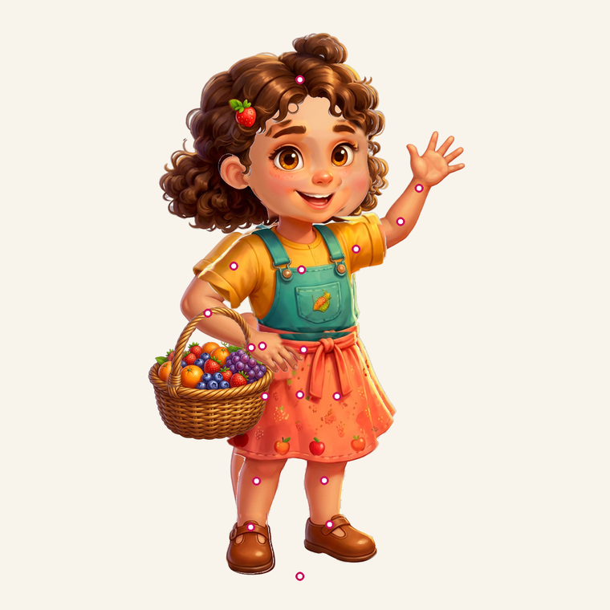
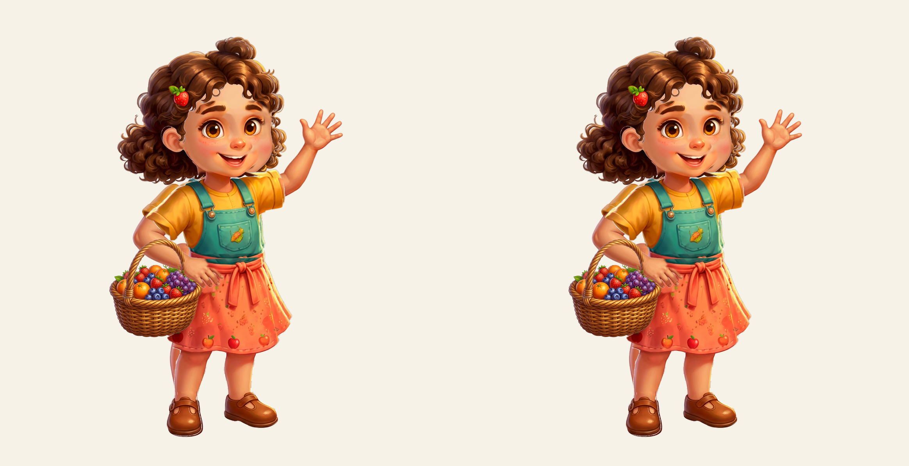
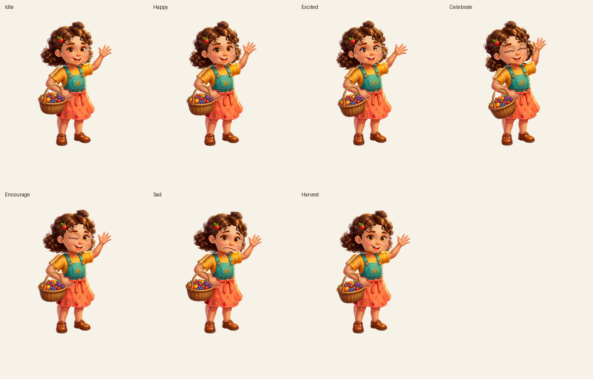

# Character rig — میوه‌چین

The orchard guide is drawn from the **delivered doll-maker art**, split into
independently movable parts. Nothing in this pipeline repaints the character: the
build script only crops the source layers and bakes small joint fills, so the
face, proportions, palette and style are exactly the ones that were supplied.

## 1. Source material (verified, not assumed)

`assets/characters/guide-rig/` contains 31 numbered layers on one shared
1152 × 1152 canvas, plus a few assembled/derived images. Stacking the 31 numbered
layers in numeric order reproduces `assets/characters/expressions/happy/character.png`
with **mean absolute difference 0.0003** and no pixel above 30/255 — so the
delivered stack order is the authoritative draw order and is what the rig uses.

| Group | Layers |
| --- | --- |
| Legs | `01_left-thigh`, `02_right-thigh`, `03_left-calf`, `04_right-calf`, `05_left-shoe`, `06_right-shoe` |
| Hair | `07_back-hair`, `24_front-hair-left`, `25_front-hair-right`, `31_strawberry-hairclip` |
| Arms | `08_upper-arm-wave`, `09_forearm-wave`, `10_hand-wave`, `11_upper-arm-carry`, `28_forearm-carry`, `30_hand-carry` |
| Head | `12_head-and-neck` |
| Body | `13_body-and-overalls`, `14_skirt`, `26_waist-bow` |
| Face | `15`/`16` eyebrows, `17`/`18` eyes, `19`–`22` eyelids, `23` mouth |
| Basket | `27_basket-bowl`, `29_basket-handle` |

`assets/characters/expressions/<mood>/` adds seven complete expression sets plus
a shared `details` plate (blush/tears) for `excited`, `sad` and `crying`.

### Known art gaps (reported, not guessed)

* The **nose is baked into `12_head-and-neck`**; the separate `nose.png` is a
  duplicate with a slightly different blend, so the rig deliberately does not
  draw it (drawing it would shift the rest pose).
* **No closed-eye art for `surprised`** (and none for `excited`/`sad`/`crying`);
  winking/laughing supply the only true closed eyes. The rig therefore blinks
  only in moods whose set ships closed eyes — `idle`, `happy`, `encourage`.
* Both arms ship in exactly **two** authored poses (wave / carry). Free-form arm
  choreography would need extra painted arm angles.
* Mouth/eyes change expression by swapping the delivered plates for that mood;
  there are no in-between mouth shapes.

## 2. Build step

```
python3 tools/character_rig/build_rig_assets.py     # needs Pillow + numpy
```

Outputs (all committed, ~1.6 MB):

```
assets/characters/rig/
  manifest.json        # joints, bones, layer rects/pivots/z-order, face sets
  report.json          # verification metrics (see below)
  layers/*.png         # 31 body/face crops + 24 expression plates
  sockets/*.png        # 9 joint fills (neck, elbows, wrists, knees, ankles)
```

Every layer is a **lossless crop** of the 1152² source; `manifest.json` stores
the crop rect, the bone it belongs to, its pivot and its paint order, so the
Dart renderer reconstructs the canvas without a second copy of the art.

Sockets are built from the rest-pose pixels of the parent ∪ child around a
joint. They are painted *between* the parent and the child layer, so at rest
they repaint identical pixels, and when a joint rotates they fill the wedge that
would otherwise become transparent. Shoulders and hips need no socket: the
delivered stacking already tucks both upper arms behind the torso and both
thighs behind the skirt.

### Verification (from `report.json`)

| Check | Result |
| --- | --- |
| Rest pose vs `expressions/happy/character.png` | mean 0.0009, 4 px > 30 (all ≤ 1 alpha) |
| `happy` | mean 0.0019 |
| `excited` | mean 0.0055 |
| `laughing` | mean 0.0020 |
| `winking` | mean 0.0017 |
| `sad` | mean 0.0023 |
| `crying` | mean 0.0036 |
| `surprised` | mean 0.0094 |

## 3. Bones



```
root ─┬─ body ─┬─ neck ─┬─ hairBack / hairFrontL / hairFrontR / clip
      │        │        └─ faceBrows / faceEyes / faceMouth / faceDetails
      │        ├─ armRUpper ─ armRFore ─ armRHand
      │        └─ armLUpper ─ armLFore ─ armLHand ─ basket
      ├─ skirt / bow
      ├─ legL ─ calfL ─ shoeL
      └─ legR ─ calfR ─ shoeR
```

Pivots were measured from the art (centroid of the parent ∩ child overlap for
each joint, neck width for the neck), not eyeballed from a design file.

## 4. Animation

`lib/ui/widgets/guide_character/guide_rig_animator.dart` is the whole
performance; it is a pure function of `(mood, seconds)` and returns bone angles:

| Mood | Motion |
| --- | --- |
| Idle | 4.6 s breathing through the waist/neck, hair sway ±1.1°, tiny arm drift |
| Happy | wave from shoulder + forearm + wrist, head tilt, hair follow-through |
| Excited | bigger wave, small hop via root offset and knee flex |
| Celebrate | two-handed raise, hop, bow swing, fastest hair |
| Encourage | gentle lean-in nod, inviting hand, basket sway |
| Sad | head drops 7.5° and sinks 5 px, shoulders curl, basket hangs |
| Harvest | left arm dips into the basket, basket swings −7°, head looks down |

Rules encoded in the tests:

* every mood starts from `RigPose.rest` at `t = 0`;
* no bone is ever scaled (only rotation + small offsets);
* the root only moves vertically, and by ≤ 6 px, during hops;
* per-bone angles stay under 48°, the idle loop under 1.2°.

Blinking is scheduled deterministically (2.6 s – 6.6 s apart, occasional double
blink) and draws the *delivered closed-eye plates* on top of the open eyes — no
transparency tricks.

### Rest pose vs the delivered art



Left: the rig with every bone at 0. Middle: the delivered art. Right:
amplified difference (×10) — black means identical.

### Mood poses



## 5. Runtime rules

* `GuideRig.load()` decodes the package **once** per process and shares it.
* `GuideCharacter` owns exactly one `Ticker`; it is stopped when `paused` is
  true, when `MediaQuery.disableAnimations` is set, or when the app leaves the
  foreground, and disposed with the widget.
* A ticking frame only repaints (`CustomPaint` + `Listenable`); it never rebuilds
  the element tree and never decodes an image.
* The widget is wrapped in `IgnorePointer`, so it can never steal board taps.

## 6. Gallery

```
flutter run -t lib/ui/features/character_lab/main.dart
```

`GuideRigLabScreen` plays all seven moods, the auto-cycle, a Reduce Motion toggle,
a "compare with rest art" mode and a height slider preset to 190 px — the height
the board actually uses on a 360×800 phone.
